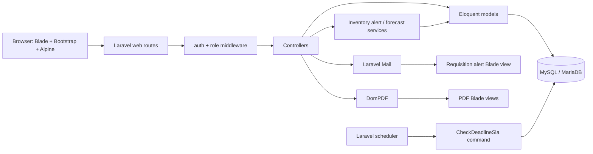
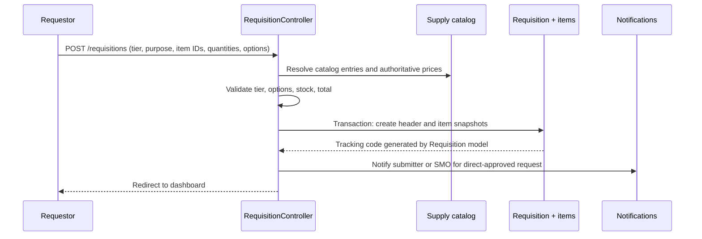
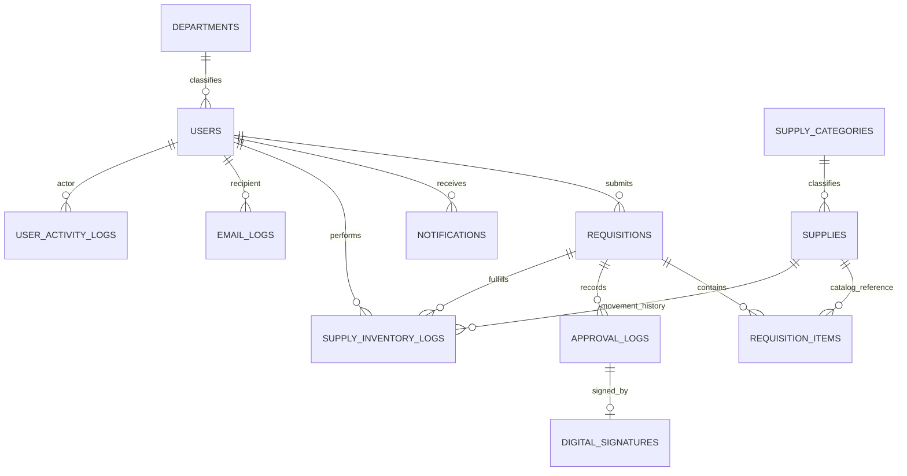

# HTC Supply Management System: Architecture and Data Flow

This document describes the first-party application code in this repository as inspected on 2026-10-01. It covers the Laravel runtime, user-facing flows, persistence model, validation, authorization, and the responsibility of application methods. Laravel's `vendor/`, npm's `node_modules/`, generated assets, and local `.env` secrets are not application-owned source and are not catalogued here.

## 1. System at a glance

The application is a server-rendered Laravel 12 system. HTTP routes dispatch to controllers, controllers validate input and coordinate Eloquent models/services, and Blade templates render the response. The central domain is a multi-item requisition moving through role-specific approvals and then SMO stock fulfillment.



### Technology and process boundaries

| Area                | Implementation                                                      | Connection to the system                                                                              |
| ------------------- | ------------------------------------------------------------------- | ----------------------------------------------------------------------------------------------------- |
| Runtime/backend     | PHP 8.2+, Laravel 12, Eloquent                                      | Route dispatch, validation, authorization, business workflows, persistence                            |
| Database            | MySQL/MariaDB in normal setup; in-memory SQLite in PHPUnit          | Requisitions, catalog, accounts, inventory, approvals, notifications, audit records                   |
| UI                  | Blade templates, Bootstrap 5, Alpine.js                             | Server-rendered pages and interaction controls; `resources/js/app.js` starts Bootstrap and Alpine     |
| Assets              | Vite, `resources/css/app.css`, `resources/js/app.js`                | Produces `public/build`; `vite.config.js` declares the two source entry points                        |
| PDF                 | `barryvdh/laravel-dompdf`                                           | Renders requisition documents, report exports, and inventory forecasts from Blade                     |
| Email               | Laravel Mail                                                        | Sends approval/release messages and records delivery outcomes in `email_logs`                         |
| Background schedule | `routes/console.php` schedules deadline checks and notification pruning in the configured timezone | Docker starts `schedule:work`; non-Docker hosts must invoke Laravel's scheduler                        |
| Container           | Node build stage + PHP 8.3 Apache stage                             | Builds assets, installs production Composer dependencies, runs config cache/migrations, serves Apache |

## 2. Repository structure and responsibilities

| Path                                       | Responsibility                                                                                                                                 |
| ------------------------------------------ | ---------------------------------------------------------------------------------------------------------------------------------------------- |
| `routes/web.php`                           | Dashboard data assembly and application HTTP routes, middleware groups, controller mappings                                                    |
| `routes/auth.php`                          | Guest registration/login/password reset and authenticated password/email verification endpoints                                                |
| `routes/console.php`                       | Artisan command registration and daily deadline schedule                                                                                       |
| `app/Http/Controllers/`                    | HTTP use cases: requisitions, approvals, inventory, personnel, reports, archives, profile, authentication                                      |
| `app/Http/Requests/`                       | Reusable FormRequest validation for login and profile updates                                                                                  |
| `app/Http/Middleware/RoleManager.php`      | Named `role` middleware; rejects a user whose role is not in the route's allowed list                                                          |
| `app/Models/`                              | Eloquent entities, relationships, casts, accessors, and requisition lifecycle helpers                                                          |
| `app/Services/`                            | Reusable stock-threshold notifications and historical inventory demand forecasting                                                             |
| `app/Console/Commands/`                    | Scheduled SLA notification job                                                                                                                 |
| `app/Mail/`                                | Requisition alert email definition and view binding                                                                                            |
| `app/View/Components/`                     | Blade layout components                                                                                                                        |
| `app/Providers/AppServiceProvider.php`     | Bootstrap-wide view data and Bootstrap paginator configuration                                                                                 |
| `resources/views/`                         | Blade pages grouped under `admin`, `auth`, `emails`, `inventory`, `layouts`, `notifications`, `profile`, `requests`, and reusable `components` |
| `resources/css/`, `resources/js/`          | Frontend source; no separate SPA/router is present                                                                                             |
| `database/migrations/`                     | Ordered schema history, including the transition from the original single-item request prototype                                               |
| `database/seeders/`, `database/factories/` | Reference departments, workflow accounts, catalog categories, legacy tracking backfill, and test data generation                               |
| `tests/Feature/`, `tests/Unit/`            | HTTP workflow contracts and focused domain/service checks                                                                                      |
| `config/`, `.env.example`                  | Framework/environment configuration; actual deployment values belong in environment variables, not this document                               |
| `Dockerfile`, `docker/`, `render-build.sh` | Container build/Apache startup and deployment build support                                                                                    |
| `public/`                                  | Laravel front controller, static public files, and compiled Vite assets                                                                        |

## 3. Runtime entry points and route flow

`bootstrap/app.php` connects `routes/web.php`, `routes/console.php`, and Laravel's `/up` health route. It aliases `role` to `RoleManager`, and trusts proxies from any address (`*`); deployments should ensure the application is only reachable through trusted proxy infrastructure.

The root route redirects to login. `/dashboard` dispatches to the authenticated `DashboardController`: it computes employee request counters, approver-specific queues, and SMO statistics, then renders `resources/views/dashboard.blade.php`. See [the October 21 SMO dashboard review](docs/SMO-DASHBOARD-REVIEW.md) for its metric definitions, fixes, and validation. Other routes are grouped by authentication and role:

| Route family                                       | Main controller/action                                                                                                                                                    | Who may enter per route middleware                                                  |
| -------------------------------------------------- | ------------------------------------------------------------------------------------------------------------------------------------------------------------------------- | ----------------------------------------------------------------------------------- |
| `/requests`, `/requests/archive`, `POST /requests` | `RequestController` index/archive; `RequestController::store` is registered, but the current multi-item form submits to `RequisitionController::store` at `/requisitions` | Authenticated                                                                       |
| `/requisitions` and `/requisitions/{id}` edits     | `RequisitionController` store/edit/update/destroy                                                                                                                         | Authenticated; controller further scopes changes to request owner and pending state |
| `/admin/approvals`, status, release                | `RequestController` approval queue, status transition, release                                                                                                            | Listed signatory roles and SMO                                                      |
| `/inventory/**`                                    | `SupplyController` inventory list, create/update/delete, forecast/PDF                                                                                                     | SMO only                                                                            |
| `/admin/users/**`                                  | `ProfileController` pending approval and personnel administration                                                                                                         | Route role group plus controller-level target checks for management                 |
| `/admin/reports/**`                                | `ReportController` report workspace, CSV/PDF                                                                                                                              | SMO only                                                                            |
| `/admin/archive`                                   | `ArchiveController::index`                                                                                                                                                | No auth/role middleware declared on this route                                      |
| `/requests/{id}` and `/requests/{id}/download`     | `RequestController::show` / `downloadPDF`                                                                                                                                 | No auth/ownership middleware declared on these routes                               |
| `/notifications`, runtime APIs                     | `RequestController` notification views/polling                                                                                                                            | Authenticated; runtime-state endpoint also throttled to 20 requests/minute          |
| login/register/password/email verification         | Controllers in `app/Http/Controllers/Auth`                                                                                                                                | Guest or authenticated route groups in `routes/auth.php`                            |

`RoleManager::handle` first requires a signed-in session, trims the allowed role strings, then redirects disallowed users to the dashboard. This is a route-level gate; use-case-specific ownership and approval-stage checks are additional controller rules rather than policies/gates.

## 4. Main data flows

### 4.1 Account registration and access

1. `RegisteredUserController::store` normalizes text, validates institution-specific identity fields, and creates an unapproved `employee` user.
2. If an SMO account exists, a persistent notification is written for it. The user receives a registration event and a pending-approval message.
3. `ProfileController::pendingUsers` displays accounts awaiting approval. `approveUser` validates an assignable role, approves the account, and creates an activation notification.
4. `LoginRequest::authenticate` rate-limits attempts, finds an account by username or school ID, checks the password, blocks unapproved accounts, logs successful authentication, and authenticates the session.
5. `AuthenticatedSessionController` regenerates the session on login and invalidates it on logout.

### 4.2 Requisition creation and changes

1. Authenticated browser submits to `POST /requisitions` (`RequisitionController::store`).
2. The controller validates the request tier, purpose and nested item structure; resolves each `supply_id` from the catalog; ensures each item belongs to that tier; checks stock; checks request options against catalog-configured choices; computes prices/totals from catalog values rather than browser prices; and enforces the PHP 1,000 minor-tier ceiling.
3. A DB transaction creates the requisition header and copied line-item snapshots (name, specs, quantity, unit, unit price, subtotal). `Requisition::booted` creates the tracking number after the header is inserted.
4. A president/provost submission starts at `approved_president` and alerts the SMO; other users start at `pending` and get a submission notification.
5. Only the owner can edit/delete, and only while status is `pending`. Updates must include every existing line item exactly once; values and totals are recalculated against current catalog records inside a transaction.



### 4.3 Approval state machine

`RequestController::adminIndex` builds the queue for the current role. `updateStatus` validates the decision and asks `canReviewRequisition` whether the current user owns that state transition. The implemented standard sequence is:

| Current state                                    | Eligible reviewer                                  | Approval result                            |
| ------------------------------------------------ | -------------------------------------------------- | ------------------------------------------ |
| `pending`                                        | `dept_head` whose department matches the requestor | `approved_dept`                            |
| `approved_dept` + `minor`                        | `vp_finance`                                       | `approved_vp` (SMO-ready minor)            |
| `approved_dept` + `major`                        | `vp_admin`                                         | `approved_vp`                              |
| `approved_vp` + `major`                          | `provost`                                          | `approved_provost`                         |
| `approved_provost` + `major`                     | `president`                                        | `approved_president` (SMO-ready major)     |
| `approved_vp` + `minor`, or `approved_president` | SMO starts fulfillment                             | `processing`                               |
| `processing`                                     | SMO prepares and deducts stock                     | `ready_for_pickup`                         |
| `ready_for_pickup`                               | SMO confirms handoff                               | `completed`                                |
| A reviewable state                               | Its current reviewer                               | `rejected` or `for_clarification`          |

Every decision updates requisition status/remarks and creates an `ApprovalLog`; approval decisions additionally create a `DigitalSignature`. Clarification notifications go to the requestor and all SMO users. Each decision also attempts an email and records sent/failed status. The approval decision itself is not wrapped in a transaction, unlike requisition create/update and stock release.

### 4.4 SMO fulfillment and SLA alerts

SMO fulfillment is split into `startProcessing`, `markReadyForPickup`, and `completeRequest`. The preparation transaction resolves each line item by its saved `supply_id` (with a legacy name fallback), rejects insufficient stock, decrements matching catalog quantities, detects low/out-of-stock threshold crossings, writes `SupplyInventoryLog` deductions, changes status to `ready_for_pickup`, creates the audit/signature record, and sends pickup notices. Completion is recorded only after SMO confirms the handoff. A line item with no matching supply record is treated as a special/non-catalog item and does not decrement stock.

`InventoryAlertService::notifyIfThresholdCrossed` only sends alerts when an item newly crosses into low or out-of-stock state. `BusinessDaySlaService` fixes the deadline at submission, skips weekends and configured institutional holidays, and does not reset it as approvals advance. `CheckDeadlineSla::handle` scans all active requests daily and notifies the requestor, SMO, and current approver while avoiding duplicate same-day alerts.

### 4.5 Inventory and forecasting

`SupplyController` restricts catalog management to SMO. Create/update validates the item, tier, quantity, pricing, threshold, category and up to five configurable option groups. `normalizeOptions` parses comma-separated choices, canonicalizes Brand, and requires at least one brand; `brandSummary` writes its compact legacy `brand` column representation.

`InventoryForecastService::build` reads up to 24 months of `release_deduction` log entries, computes monthly use, recent and seasonal averages, then calculates projected demand, safety stock, target stock and recommended ordering. The inventory page supports monthly/quarterly forecasts and a landscape PDF. Forecast confidence is a rule-based label, not a statistical confidence interval.

### 4.6 Reports, notifications, and refresh

- `ReportController::index` assembles summary KPIs and selects one of eight tabular reports: requisitions, inventory, department spending, users, item consumption, approval audit, inventory movements, or user activity. It returns the report page or produces CSV/PDF output.
- `NotificationController::index` displays a user's categorized notification feed and returns an HTML feed fragment for in-place category and pagination updates. Read state changes only through explicit authenticated actions.
- `RequestController::runtimeState` returns a compact fingerprint of requisitions, approvals and supplies plus batches of unread notifications after a cursor ID. `/api/system-version` returns the fingerprint only; `/api/latest-notification` remains as a compatibility endpoint.

## 5. Persistence model and relationships



| Model/table                                    | Purpose and important links                                                                                                                                                                                          |
| ---------------------------------------------- | -------------------------------------------------------------------------------------------------------------------------------------------------------------------------------------------------------------------- |
| `User` / `users`                               | Login identity, role, approval state, department text/code plus optional `department_id`; owns requisitions and receives notifications (notification relationship is queried directly rather than declared on model) |
| `Department` / `departments`                   | Department code/name lookup; has users                                                                                                                                                                               |
| `Supply` / `supplies`                          | Inventory master, tier, options JSON, quantity/pricing/minimum; belongs to category and has inventory logs                                                                                                           |
| `SupplyCategory` / `supply_categories`         | Category lookup; has supplies                                                                                                                                                                                        |
| `Requisition` / `requisitions`                 | Request header, owner, tier, status, tracking number, purpose, remarks, total; has items and approval logs                                                                                                           |
| `RequisitionItem` / `requisition_items`        | Snapshot of requested line data plus nullable link to catalog supply; belongs to requisition and supply                                                                                                              |
| `ApprovalLog` / `approval_logs`                | Append-style workflow action/role/remarks; belongs to requisition and has one signature                                                                                                                              |
| `DigitalSignature` / `digital_signatures`      | Signature hash, signer/role, IP/user-agent/time; unique one-to-one approval-log link                                                                                                                                 |
| `SupplyInventoryLog` / `supply_inventory_logs` | Signed quantity change and resulting balance, actor and optional requisition link; source for demand forecast and movement report                                                                                    |
| `Notification` / `notifications`               | Per-user in-app alerts and read state                                                                                                                                                                                |
| `EmailLog` / `email_logs`                      | Outgoing email status, recipient, subject and failure detail                                                                                                                                                         |
| `UserActivityLog` / `user_activity_logs`       | User action with IP and user-agent; currently login success is the explicit writer seen in app code                                                                                                                  |
| Framework tables                               | `password_reset_tokens`, `sessions`, cache, jobs, batches, failed jobs support Laravel infrastructure                                                                                                                |

The original `supply_requests` / `request_items` single-item prototype tables are legacy schema history; a later migration drops them. Current workflows use `requisitions` / `requisition_items`.

## 6. Validation and authorization rules

| Entry point             | Validation / guardrails in source                                                                                                                                                                                                                                                                  |
| ----------------------- | -------------------------------------------------------------------------------------------------------------------------------------------------------------------------------------------------------------------------------------------------------------------------------------------------- |
| Registration            | Name is restricted to letters/spacing/punctuation; username 4-30 ASCII alpha-dash and unique; school ID `99999-9999` shape and unique; department in the five institution codes; email must match the institutional domain and be unique; password confirmed, 8-64 characters, letters and numbers |
| Login                   | `login` and password required; five attempts per username/school-ID + IP throttle; password hash check; account must be approved; the lookup currently searches username or school ID (not email)                                                                                                  |
| Profile update          | Normalizes name/username/department/email; username/email unique except current account; department code must exist; profile photo (when supplied) must be an image up to 2 MB                                                                                                                     |
| Requisition create      | Tier `minor                                                                                                                                                                                                                                                                                        | major`, purpose 10-500 chars, at least one item; each catalog ID exists, quantity integer >=1, options array/string limits; tier must match each supply; available quantity checked per item and in aggregate; selected options must belong to configured choices; minor grand total <= PHP 1,000 |
| Requisition update      | Request owner and `pending` status required; purpose 10-500 chars; all original item IDs included exactly once; quantities positive; supply still exists and still matches request tier; requested amount cannot exceed catalog stock; recalculated minor total <= PHP 1,000                       |
| Approval                | Decision is one of `approved`, `rejected`, `clarification`; remarks nullable string up to 1,000 chars; `canReviewRequisition` verifies current stage, tier and (for department head) department; clarification can only be resolved by the role that initiated it                                  |
| Inventory create/update | Unique item name, allowlisted category, valid tier, specification >=3 chars, quantity/minimum >=0, price >=0.01, bounded unit/model/options; normalized option groups require Brand and combined brand string <=255 chars                                                                          |
| Forecast PDF            | `period` required and one of `monthly                                                                                                                                                                                                                                                              | quarterly`                                                                                                                                                                                                                                                                                        |
| Reports                 | Report type and period restricted to known values; dates validated and end date cannot precede start; report filters are consumed by individual report builders                                                                                                                                    |
| Personnel management    | Role allowlist depends on manager; manager cannot update self; department head limited to employee accounts in own assigned department; department code must exist; account approval flag must be boolean                                                                                          |
| Password operations     | Framework password-reset token flow; current password required for change; new password confirmed and uses Laravel password defaults                                                                                                                                                               |
| Route access            | `auth` middleware and `role` groups are the main perimeter; controller checks additionally enforce request ownership/state and reviewer assignment                                                                                                                                                 |

Validation is split between inline `$request->validate(...)`, `LoginRequest`, `ProfileUpdateRequest`, database uniqueness/foreign-key constraints, and controller authorization checks. The database schema does not encode the full requisition status transition graph or role enum as check constraints; the workflow controller is the primary state-machine enforcement point.

## 7. First-party function guide

The notes below describe the purpose of each declared application method/function in `app/`. Framework callbacks, SQL closures, and anonymous route/view closures are explained at their owning flow rather than repeated individually.

### RequestController

| Method                  | Responsibility                                                                                                                             |
| ----------------------- | ------------------------------------------------------------------------------------------------------------------------------------------ |
| `systemVersion`         | Exposes the current system fingerprint as a non-cacheable JSON response.                                                                   |
| `runtimeState`          | Combines the fingerprint, latest notification cursor, and next unread notification for the authenticated user.                             |
| `runtimeVersion`        | Hashes aggregate update markers from requisitions, approval logs, and supplies for lightweight change detection.                           |
| `index`                 | Lists active requisitions with owner privacy, search/status/department/date filters, counts and pagination.                                |
| `archive`               | Lists completed/rejected requisitions, scoped to the owner unless SMO, with filters and pagination.                                        |
| `adminIndex`            | Builds role-specific approval queues and clarification lists; only deep-links to an item already in the current approval queue.            |
| `updateStatus`          | Validates approval/rejection/clarification, checks reviewer authority, changes state, writes log/signature, and sends notifications/email. |
| `canReviewRequisition`  | Encodes the valid role and request-state transition, including department and clarification-origin checks.                                 |
| `startProcessing`       | SMO-only transition from final approval into active fulfillment.                                                                           |
| `markReadyForPickup`    | SMO-only preparation transaction: checks stock, deducts inventory, audits, signs, and sends pickup notices.                               |
| `completeRequest`       | SMO-only confirmation that the prepared supplies were handed to the requestor.                                                             |
| `NotificationController::index` | Loads and categorizes personal notifications, resolves action targets in batches, and returns either the full center or an AJAX feed fragment. |
| `show`                  | Loads a request with owner/items/log signatures and renders tracking details.                                                              |
| `downloadPDF`           | Renders a request with its history and signatures into a portrait PDF download.                                                            |
| `sendAlert`             | Inserts a per-user in-app notification.                                                                                                    |
| `NotificationController::poll` | Compatibility notification polling endpoint; returns a bounded batch of unread notifications after an optional ID.                    |
| `sendEmailNotification` | Sends `RequisitionAlertMail`; writes success/failure to `email_logs` and suppresses transport exceptions from the request.                 |

### RequisitionController

| Method                    | Responsibility                                                                                                              |
| ------------------------- | --------------------------------------------------------------------------------------------------------------------------- |
| `store`                   | Validates catalog-based submission, calculates totals, creates header/items transactionally, and notifies requester or SMO. |
| `validateSelectedOptions` | Enforces every configured supply option value, applying a default only for a single-choice group.                           |
| `edit`                    | Loads the current user's request and shows the edit form only while it remains pending.                                     |
| `update`                  | Validates a complete one-to-one item update, recomputes prices/totals from catalog, then transactionally saves it.          |
| `destroy`                 | Deletes only the current user's pending request; dependent lines cascade from schema.                                       |

### SupplyController

| Method             | Responsibility                                                                                                    |
| ------------------ | ----------------------------------------------------------------------------------------------------------------- |
| `index`            | Orders inventory by urgency, validates/defaults forecast period, builds forecast and renders inventory workspace. |
| `forecastReport`   | Validates monthly/quarterly period, creates landscape forecast PDF.                                               |
| `create`           | Displays the new-supply form.                                                                                     |
| `store`            | Validates and normalizes new supply, syncs category FK, persists it and checks thresholds.                        |
| `edit`             | Loads and displays one supply edit form.                                                                          |
| `update`           | Validates changes, captures prior stock state, updates item/category/options and checks threshold crossings.      |
| `destroy`          | Deletes a supply catalog record.                                                                                  |
| `normalizeOptions` | Converts submitted option-name/value rows to unique trimmed choices, with canonical required Brand choices.       |
| `brandSummary`     | Stores a comma-separated legacy brand summary and enforces its database-sized limit.                              |
| `orderedSupplies`  | Returns all supplies sorted out-of-stock first, low-stock second, then healthy, with name tie-break.              |

### ProfileController

| Method                 | Responsibility                                                                                                                        |
| ---------------------- | ------------------------------------------------------------------------------------------------------------------------------------- |
| `edit`                 | Renders profile plus department lookup values.                                                                                        |
| `update`               | Validates profile fields, stores/replaces optional photo, syncs department FK, resets email verification on email change, saves.      |
| `pendingUsers`         | Lists unapproved accounts except the acting SMO.                                                                                      |
| `approveUser`          | Validates a role, approves a pending account, and notifies that account.                                                              |
| `manageUsers`          | Checks manager role, scopes department-head lists, searches users, and prepares manageable targets/roles for the view.                |
| `updateManagedUser`    | Rechecks actor/target authority, validates role/department/approval fields, applies role-specific scope, updates and notifies target. |
| `ensureCanManageUsers` | Allows only SMO, president, provost, VP admin, and department head to enter personnel-management logic.                               |
| `canManageTarget`      | Prevents self-management; enforces manager-specific target roles and same-department scope.                                           |
| `assignableRolesFor`   | Returns all roles for SMO, employee only for department head, and employee/department-head for school administrators.                 |
| `allAssignableRoles`   | Defines the complete role list accepted for account approval and SMO updates.                                                         |

### ReportController

| Method                     | Responsibility                                                                                                  |
| -------------------------- | --------------------------------------------------------------------------------------------------------------- |
| `index`                    | Validates filters, assembles dashboard KPIs, builds selected report, and returns page/CSV/PDF based on request. |
| `generate`                 | Compatibility endpoint delegating to `index`.                                                                   |
| `buildReport`              | Selects one report builder and packages report type and period label.                                           |
| `requisitionReport`        | Creates one row per requisition item with requestor, tracking, status, item snapshot and totals.                |
| `inventoryReport`          | Reports current catalog, stock health and asset value; supports category/low/out filters.                       |
| `departmentSpendingReport` | Aggregates released volume and costs by department.                                                             |
| `userReport`               | Lists personnel identity, department, role, approval status and registration date.                              |
| `itemConsumptionReport`    | Aggregates released quantities and item costs, optionally by requestor department/date.                         |
| `approvalAuditReport`      | Exports approval actions, remarks, signer and partial signature reference.                                      |
| `inventoryMovementReport`  | Exports supply movement logs, stock changes/balances, officer and related requisition.                          |
| `userActivityReport`       | Exports user audit activity with account context and network/client data.                                       |
| `reportResult`             | Normalizes title, rows, columns and summary into the shared report contract.                                    |
| `column`                   | Creates the key/label/type descriptor used by preview and export templates.                                     |
| `pdfContext`               | Adds report purpose, data basis, classification, filters, metrics, group breakdown and interpretive notes.      |
| `reportMetrics`            | Derives report-specific summary measures and appends the report total.                                          |
| `reportNotes`              | Adds row-count, summary and report-specific interpretation notes.                                               |
| `appliedFilterSummary`     | Converts active filter parameters into a printable label string.                                                |
| `applyDateRange`           | Applies inclusive start/end-of-day timestamps to a query builder.                                               |
| `resolvePeriod`            | Maps selected period to concrete dates and display label.                                                       |
| `currentSemester`          | Maps calendar month to the configured January-May, June-July, or August-December academic term.                 |
| `customPeriodLabel`        | Formats user-selected date bounds for display.                                                                  |
| `downloadCsv`              | Streams UTF-8-BOM CSV and prefixes formula-leading values to reduce spreadsheet formula execution risk.         |

### Other HTTP/auth functions

| Class/methods                                          | Responsibility                                                                                                               |
| ------------------------------------------------------ | ---------------------------------------------------------------------------------------------------------------------------- |
| `ArchiveController::index`                             | Lists released requests and calculates today/week/month statistics for the separate SMO archive workspace.                   |
| `RoleManager::handle`                                  | Ensures authentication and membership in route-provided roles, then continues or redirects.                                  |
| `RegisteredUserController::create/store`               | Shows registration and normalizes/validates/creates a pending employee account, notifies SMO and fires registration event.   |
| `AuthenticatedSessionController::create/store/destroy` | Shows login, authenticates/regenerates session, routes unapproved accounts to pending screen, and securely logs out.         |
| `PasswordResetLinkController::create/store`            | Shows reset-link form and requests reset email with neutral response.                                                        |
| `NewPasswordController::create/store`                  | Shows reset form, validates token/password, updates hash/remember token and fires reset event.                               |
| `PasswordController::update`                           | Requires current password and updates the authenticated user's password.                                                     |
| `ConfirmablePasswordController::show/store`            | Displays confirmation form, checks password and timestamps session confirmation.                                             |
| `EmailVerificationPromptController::__invoke`          | Redirects verified users or renders the verification prompt.                                                                 |
| `VerifyEmailController::__invoke`                      | Verifies the signed-in account and emits the verified event.                                                                 |
| `EmailVerificationNotificationController::store`       | Resends verification email unless the account is already verified.                                                           |
| `LoginRequest::authorize/rules`                        | Allows login form submission and requires a login identifier/password.                                                       |
| `LoginRequest::authenticate`                           | Performs rate limiting, username/school-ID lookup, password and account approval checks, session login and activity logging. |
| `LoginRequest::ensureIsNotRateLimited/throttleKey`     | Emits lockout event after five attempts and builds normalized login+IP throttle key.                                         |
| `ProfileUpdateRequest::rules`                          | Declares profile field format, uniqueness and department existence constraints.                                              |
| `ProfileUpdateRequest::prepareForValidation`           | Trims/canonicalizes profile values before validation.                                                                        |

### Services, models, mail, views, and boot hooks

| Class/methods                                                          | Responsibility                                                                                                                             |
| ---------------------------------------------------------------------- | ------------------------------------------------------------------------------------------------------------------------------------------ |
| `InventoryAlertService::notifyIfThresholdCrossed`                      | Compares prior/current low/out states and notifies every SMO only on a newly crossed threshold.                                            |
| `InventoryForecastService::build`                                      | Builds historical usage, seasonal/recent projections, safety stock, suggested orders, urgency and confidence metadata.                     |
| `InventoryForecastService::reason`                                     | Produces a human-readable explanation for forecast recommendation basis.                                                                   |
| `User::academicDepartment`                                             | Belongs-to relation for normalized department FK.                                                                                          |
| `User::casts`                                                          | Casts verification timestamp and hashes assigned passwords.                                                                                |
| `User::isAdmin/isSMO/isEmployee/isDeptHead/isVP/isProvost/isPresident` | Convenience role predicates; note `admin` and `vp` do not match the current route role vocabulary (`smo`, `vp_admin`, `vp_finance`, etc.). |
| `Requisition::booted`                                                  | Creates tracking number after insert using tier, requestor department and row ID.                                                          |
| `Requisition::items/user/logs`                                         | Declares has-many line/log and belongs-to requestor relationships.                                                                         |
| `Requisition::getTrackingCodeAttribute/getTrackingCodeFallback`        | Exposes stored tracking number with a deterministic fallback for old rows/views.                                                           |
| `Requisition::isNearingDeadline/isOverdue`                             | Checks the fixed submission SLA against its two-working-day warning and three-working-day deadline.                                       |
| `RequisitionItem::requisition/supply`                                  | Belongs-to relationships to header and optional inventory record.                                                                          |
| `Supply::requestOptions`                                               | Reconstructs Brand and configurable choice groups, falling back to legacy brand text.                                                      |
| `Supply::supplyCategory/inventoryLogs`                                 | Category belongs-to and movement has-many relationships.                                                                                   |
| `SupplyCategory::supplies`, `Department::users`                        | Lookup-to-record has-many relationships.                                                                                                   |
| `ApprovalLog::requisition/digitalSignature`                            | Requisition belongs-to and optional one-to-one signature relation.                                                                         |
| `DigitalSignature::approvalLog`                                        | Signature belongs-to audit row.                                                                                                            |
| `SupplyInventoryLog::supply/user/requisition`                          | Links movement to catalog item, actor and optional fulfilled requisition.                                                                  |
| `EmailLog::user`, `UserActivityLog::user`                              | Optional email owner and activity actor relations.                                                                                         |
| `RequisitionAlertMail::__construct`                                    | Carries requisition and message presentation data into the mail view.                                                                      |
| `RequisitionAlertMail::envelope`                                       | Builds subject with requisition tracking code.                                                                                             |
| `RequisitionAlertMail::content`                                        | Selects `emails.requisition-alert` Blade template.                                                                                         |
| `AppLayout::render`, `GuestLayout::render`                             | Resolve the authenticated and guest layout Blade views.                                                                                    |
| `AppServiceProvider::register`                                         | No application bindings currently registered.                                                                                              |
| `AppServiceProvider::boot`                                             | Enables Bootstrap 5 pagination and shares active catalog items/unread count with authenticated layout.                                     |
| `CheckDeadlineSla::handle`                                             | Finds active requests at SLA risk, sends deduplicated alerts to stakeholders, and reports the count.                                      |
| `DatabaseSeeder::run`                                                  | Runs department then account seeders.                                                                                                      |
| `AccountSeeder::run`                                                   | Idempotently seeds approved workflow signatories and department heads with environment-configured password.                                |

Migration files expose `up()` to create/alter schema and `down()` to reverse each change. Their responsibilities are summarized in the data model and migration notes rather than treating framework migration closures as business functions.

## 8. Validation and test evidence

`phpunit.xml` defines Feature and Unit suites, uses in-memory SQLite, array cache/mail, synchronous queues and reduced bcrypt rounds. Current test names indicate explicit coverage for:

- Authentication, registration format, password reset/update/confirmation, email verification routes and unapproved accounts.
- Employee/SMO active request workspaces, dashboard data, request edits/deletes, catalog options and wrong-tier submission.
- Approval-stage authorization and clarification ownership.
- Inventory ordering, brand option input, monthly/quarterly forecasts, threshold notifications and polling.
- Report types, legacy report redirects, CSV/PDF export and departmental totals.
- Personnel-management role/department scopes and protection against granting SMO to a school administrator.
- Requisition PDF item/signature history and system version/runtime polling.
- Unit-level seasonal and quarterly forecast calculations.

This describes checked-in test intent, not a claim that the suite was run during this documentation task.

## 9. Observed gaps and operational cautions

These are current-source observations, not features to rely on as already fixed:

1. `GET /requests/{id}`, its PDF download route, and `/admin/archive` have no declared `auth` or role middleware. `show` and `downloadPDF` load by ID without checking request owner or role. Add route/controller authorization before treating those pages as private.
2. `SupplyController::update` changes quantity but does not create a `SupplyInventoryLog`; there are no current application writers for `restock_delivery` or `manual_adjustment`. Forecast/report movement history therefore reflects release deductions, not a complete stock ledger.
3. `DigitalSignature` stores a SHA-256 digest made from request/user/role/time plus `APP_KEY`, alongside signer and client metadata. There is no verifier method or public-key signature flow in the scanned application; the record is an integrity/audit token, not proof of a cryptographically verifiable human signature by itself.
4. The app model does not declare the relationship method for notifications; controllers query `Notification` directly. `User::isAdmin()` and `User::isVP()` also use role strings not used by the current route workflow, so they appear to be legacy helpers.
5. Approval state transitions lock the requisition row and transactionally persist status, audit log, signature, and in-app notifications. Email delivery remains a best-effort post-commit side effect.
6. The migration `2026_08_16_163954_refined_supplies_table_rebuild.php` explicitly drops and recreates `supplies`; applying this migration against an existing installation can discard inventory rows. Review production migration history/data before running migrations in a populated environment. A later migration drops the legacy prototype request tables.
7. `bootstrap/app.php` trusts proxies from `*`; configure this only behind appropriately controlled proxy infrastructure.
8. `Dockerfile` startup requires persistent `APP_KEY`, creates storage link, caches config, runs migrations, then starts Apache. Production email, database, session, queue and scheduler operation depend on deployment environment configuration.

## 10. Practical verification commands

```powershell
php artisan route:list
php artisan test
npm run build
```

Run these in an environment with the configured PHP/Composer/Node dependencies and a usable test database. `php artisan route:list` is especially useful for rechecking effective middleware after route edits; the route-source caveats above are based on the checked-in declarations.
